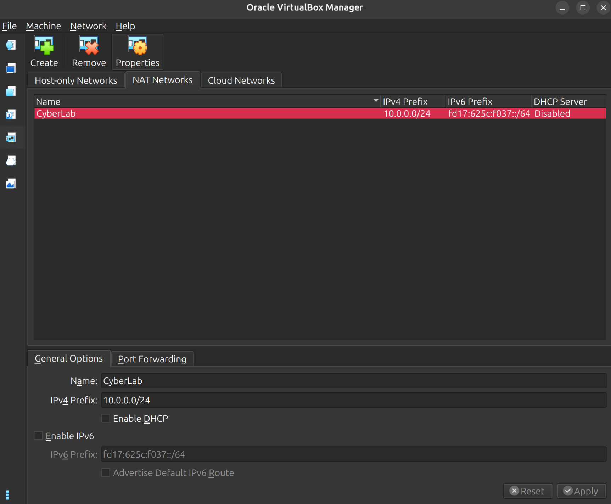
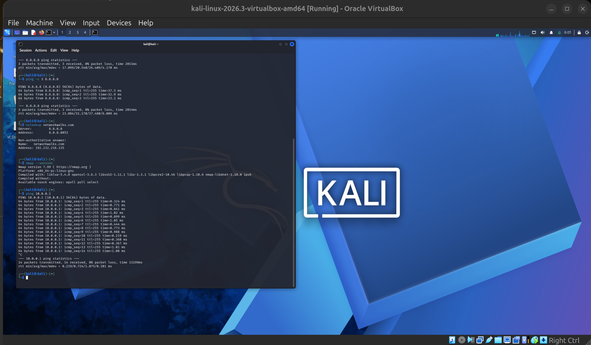
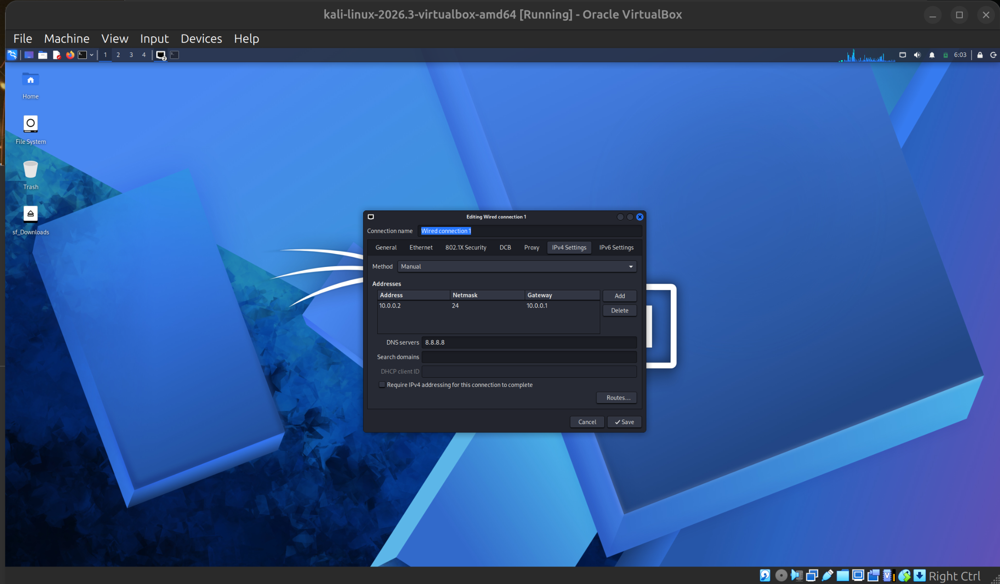

# 🔐 Cybersecurity Lab Environment Setup

**Building an isolated virtual lab for penetration testing and ethical hacking practice**


---

## 📌 Project Overview

This project sets up a **virtual cybersecurity and penetration-testing laboratory** using VirtualBox and Kali Linux, hosted on an Ubuntu machine.

The lab provides a controlled environment where security tools, network scanning, reconnaissance and vulnerability assessment can be practised safely and repeatedly.

It runs on a private virtual network so that additional machines can be added later and used as targets for authorized security testing.

---

## 🎯 Objectives

- Install and configure VirtualBox (with the Extension Pack) on an Ubuntu host.
- Install 7-Zip to extract the Kali Linux VirtualBox image.
- Import Kali Linux as a virtual machine.
- Create a private **NAT Network** for the cybersecurity lab.
- Assign a static IP address to the Kali VM.
- Verify network connectivity and DNS resolution.
- Take a clean VM snapshot for recovery.
- Document the setup, including problems and fixes.
- Prepare the environment for future cybersecurity projects.

---

## 🛡️ Purpose of the Lab

The lab provides an isolated environment for cybersecurity learning and authorized security testing. It can be used for:

- Network reconnaissance
- Port scanning
- Vulnerability assessment
- Packet analysis
- Web security testing
- Exploitation practice
- Security-tool experimentation

⚠️ **Important:** Only use this lab against systems you own or have explicit permission to test. Do not use it or its tools to attack unauthorized systems.

---

## ⚙️ Lab Configuration

| 🧩 Component        | ⚙️ Configuration                    |
|--------------------|-------------------------------------|
| 🖥️ Host OS         | Ubuntu (Linux)                      |
| 🧠 Host RAM         | 8 GB                                 |
| ⚡ Processor        | Intel Core i5                       |
| 🧰 Hypervisor       | VirtualBox 7.2.6                    |
| 🧩 Extension Pack   | Oracle VirtualBox Extension Pack 7.2.6 |
| 🗜️ Archive Tool     | 7-Zip 26.00                         |
| 🐉 Security OS      | Kali Linux 2026.3                   |
| 🧠 Kali RAM         | 5000MB                              |
| 🌐 Virtual Network  | NAT Network (`CyberLab`)            |
| 📡 Network Address  | 10.0.0.0/24                         |
| 🐧 Kali IP Address  | 10.0.0.2/24                         |
| 🚪 Default Gateway  | 10.0.0.1                            |
| 🌍 DNS Server       | 8.8.8.8                             |
| 🔮 Future VM Range  | 10.0.0.3 – 10.0.0.99                |

---

# 🪜 Lab Setup Procedure

## Step 1. Install 7-Zip

7-Zip was installed to extract the Kali Linux VirtualBox image, which is distributed as a `.7z` archive.

```bash
sudo apt install p7zip-full
```

On this Ubuntu release, `apt` selected the `7zip` package (version 26.00) in place of `p7zip-full`.

---

## Step 2. Install VirtualBox

VirtualBox was installed as the hypervisor, together with its Qt GUI.

```bash
sudo apt update && sudo apt install virtualbox virtualbox-qt
vboxmanage --version
```

Installed version:

```
7.2.6_Ubuntur172322
```

The Extension Pack was then installed:

```bash
sudo apt install -y virtualbox-ext-pack
```

---

## Step 3. Create the NAT Network

A dedicated NAT Network was created in VirtualBox (**Tools → Network → NAT Networks**).

```
Network Name: CyberLab
IPv4 Prefix:  10.0.0.0/24
DHCP:         Disabled (see Problem 1)
IPv6:         Disabled
```



A **NAT Network** was chosen because VMs on the same NAT Network can talk to each other while still having outbound Internet access. This allows future attacker and target VMs to communicate inside the lab.

---

## Step 4. Import Kali Linux

The Kali Linux VirtualBox image was downloaded from the official Kali website and extracted with 7-Zip:

```bash
cd ~/Downloads
7z x kali-linux-*-virtualbox-amd64.7z
```

This extracted `kali-linux-2026.3-virtualbox-amd64.7z` and the VM was then imported into VirtualBox.

The VM network adapter was configured as follows:

```
Adapter 1
Attached to: NAT Network
Network:     CyberLab
```



---

## Step 5. Configure the Kali Linux Network

The Kali VM was configured with a static IPv4 address:

```
IP Address:  10.0.0.2
Subnet Mask: 255.255.255.0
Gateway:     10.0.0.1
DNS:         8.8.8.8
```

A fixed IP address makes the lab easier to document and to reference in future exercises.



---

## Step 6. Create a Clean VM Snapshot

After the initial configuration, a VirtualBox snapshot was created:

```
Clean Kali - Network Setup
```

This is the clean baseline of the lab. If a future exercise damages the VM, it can be restored to this point.

---

# 🔎 Lab Verification

| ✅ Test                       | 🧾 Command                       | 🎯 Expected Result               |
|------------------------------|---------------------------------|---------------------------------|
| 🌐 Check IP address           | `ip a`                          | Correct Kali IP displayed       |
| 📡 Test gateway               | `ping 10.0.0.1`                 | Successful replies              |
| 🌍 Test Internet connectivity | `ping 8.8.8.8`                  | Successful replies              |
| 🔎 Test DNS resolution        | `nslookup networkwalks.com`     | Domain resolves                 |
| 🧰 Verify Nmap                | `nmap --version`                | Nmap version displayed          |
| 🔄 Verify snapshot            | Restore snapshot and run `ip a` | Baseline configuration restored |

### Example Results

```
IP Address:  10.0.0.2/24
Gateway:     10.0.0.1
DNS:         8.8.8.8
```

---

# 🐞 Problems Encountered & Solutions

## Problem 1. No Internet Connectivity on the Kali VM

The Kali VM had no Internet access after joining the NAT Network. The VirtualBox NAT Network's built-in DHCP server was conflicting with the static IP configured manually inside Kali.

**Solution:** disable DHCP on the VirtualBox NAT Network.

1. On the host, open the main **VirtualBox Manager** window.
2. In the left panel, find the **Tools** section, click the menu icon (three horizontal dots) next to it and select **Network**.
3. Open the **NAT Networks** tab and select the `CyberLab` network.
4. Uncheck **Enable DHCP**.
5. Apply the change and restart the Kali VM.

Because the lab uses a static IP inside Kali, VirtualBox's DHCP server is not needed. Disabling it stops it from competing with the manual configuration, and Internet connectivity was restored.

---

# 💡 What I Learned

### 1. NAT vs NAT Network
A standard NAT only isolates a single VM. A NAT Network lets several VMs share one virtual network while still reaching the Internet, which makes it suitable for a multi-machine lab.

### 2. Virtual Machine Networking
How VirtualBox network adapters connect VMs to different networks, and how that affects communication between machines.

### 3. Static IP Configuration
How to configure and verify IPv4 addresses, subnet masks, gateways and DNS in Kali Linux, and why a static address should not be combined with an active DHCP server on the same network.

### 4. VM Snapshots
A clean snapshot should be taken **before** any risky or experimental activity, giving a known-good recovery point.

### 5. Documentation
Recording commands, configuration, screenshots, problems and fixes is a core part of professional cybersecurity work.

---

# 🔐 Security & Ethical Use

This laboratory is intended strictly for educational purposes and authorized testing only.

---

# 🔗 Tools & Resources

- **7-Zip:** https://7-zip.org/download.html
- **VirtualBox:** https://virtualbox.org/wiki/Downloads
- **Kali Linux:** https://kali.org/get-kali

---

# 👤 Author

**Wathuta**
Cybersecurity Student, B084A

GitHub: https://github.com/Wathuta-ww

---

## 📌 Project Information

**Program Name:** Cybersecurity at Networkwalks | **Week:** 01 | **Project:** Cybersecurity & Pentesting Lab Setup | **Repository:** GitHub
